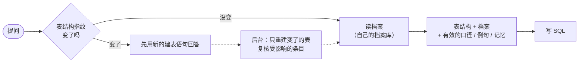
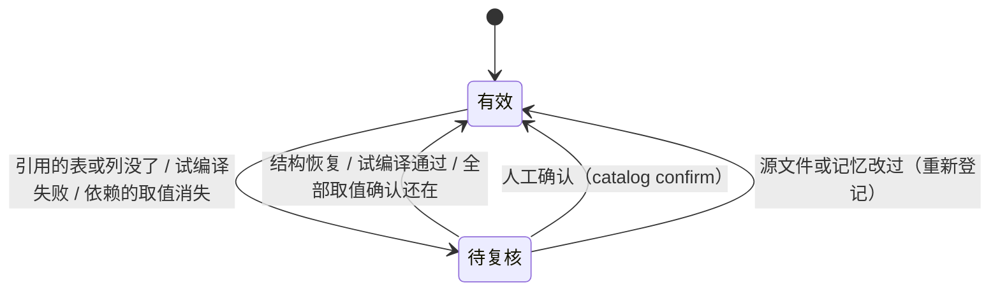

# 数据库建档与记忆同步

代码在 `src/deepquery/catalog/`，测试在 `tests/test_catalog.py`。

## 要解决的问题

1. **模型不知道数据长什么样。** SQL 写错，很多时候不是模型不会写，而是它不知道：
   - 状态存的是 `completed` 还是“已完成”；
   - 日期是 `YYYY-MM-DD` 字符串还是时间戳；
   - `satscores.cds` 要和哪张表的哪一列 JOIN。

   建表语句和三行样例回答不了这些问题。
2. **表会变，记忆不会自己跟着变。**
   - 新建的表要让 Agent 知道。
   - 删了一列以后，引用这一列的例句、业务口径、用户记忆还在照常注入提示词，会把模型带偏。

## 一次提问要做什么



每次提问只做两件事：

- **比一次结构指纹。** SQLite 读 `PRAGMA schema_version`；MySQL / PG 对 information_schema 里的列清单算哈希，最多每 5 秒查一次。
- **读档案。** 读的是 DeepQuery 自己的档案库，不是业务库：
  - 表卡片在内存里有缓存，档案版本变了才重读；
  - 这个用户新存或改过的记忆，在档案库里登记一下依赖（不查业务库）。

提问时不扫业务表，也不等建档：

- **结构刚变时，先用新的建表语句回答。** 按旧结构建的档案先不附上，免得新的建表语句后面挂着已经不存在的列。
- **后台建完档后，下一次提问自动换上新档案。** 只重新附档案，不再自省业务库。
- **新存的记忆里写的具体取值，交给后台去核对。** 比如记忆里写了 `status = 'paid'`，这个取值在库里有没有，由后台或下一次同步去查。

## 采什么、不采什么

只采会直接改变 SQL 写法的四类信息。

| 采集 | 怎么采 | 为什么 |
|---|---|---|
| 枚举取值 | 不同值不超过 30 个的文本列（数值列不超过 12 个且有重复），按出现次数列出全部取值 | 决定过滤条件怎么写 |
| 日期范围 | 识别格式：ISO 日期、`YYYYMMDD`、Unix 时间戳等。能按字符串比较大小的格式才给全表 MIN / MAX | 决定日期函数怎么用，以及“去年”有没有数据 |
| 格式样例 | 非枚举的短文本列，取 3 个不同值 | 编码、前缀、大小写的真实写法 |
| 关联关系 | 建表语句声明的外键直接采用；其余按列名找候选，再用数据核对，抽样值 ≥95% 能在对方主键里找到才算。多张表都对得上时，认行数最多的那张（主表；行数数到 100 万为止） | 决定 JOIN 怎么写 |

刻意不采、或者只在内部用的：

- **数值列的最小值和最大值不采。** 这些数字放进提示词，模型容易直接拿来当答案。
- **空值率不给具体数字。** 超过一半时只标一句“多数为空”。
- **行数只在内部用。** 用来判断抽样有没有覆盖全表，以及挑选关联的主表。

**统计的范围：**

- 统计只在每张表的前 `CATALOG_SAMPLE_ROWS`（默认 2 万）行上做，行数也只数到这个上限加一，不做全表 COUNT。大表建档的开销因此有上限。
- 抽样没覆盖全表时，枚举取值标成“可能不全”。
- 例外是日期起止，用的是全表的 MIN / MAX。
- 行数都读不出来（超时、连接断了）的表，这次不存档，也不会存成一份“空表”的错误档案。之后按 10 分钟、20 分钟……最长 1 天退避重试，期间不重复报“新增表”、不调用模型。
- 有的列不支持 `COUNT(DISTINCT)`（比如 PG 的 json）：这时这一批统计会整批失败，改为逐列重试。

所有统计 SQL 都先过 SQL 守卫，再交给只读连接执行，和 Agent 自己的查询走同一条路径。档案存在 DeepQuery 自己的 `data/catalog.sqlite` 里，业务库不会多出任何表或注释。

一张表的档案附在它的建表语句后面，长这样：

```text
-- orders 档案（2026-10-12 只读统计；标“待确认”的说明由模型生成）：
--   customer_id：关联 customers.id（外键）
--   order_date：日期，格式 YYYY-MM-DD，范围 2024-01-13 ~ 2025-06-29
--   status：取值 completed / pending / cancelled / shipped
--   coupon_code：取值 C-6 / C-3 / C-2；多数为空
```

## 三类变化怎么处理

**表结构指纹**只由每张表的列名、类型、主键和外键算出来。增删改行数据不会改变它。

| 变化 | 档案 | 依赖它的例句 / 口径 / 记忆 |
|---|---|---|
| 新增表 | 给新表建档；已有表如果有列指向它，补上关联 | 不受影响 |
| 新增列 | 只重建这一张表 | 不受影响 |
| 删除列、改名 | 只重建这一张表 | 引用了这一列的条目 → 待复核。改名会标成“疑似改名”，依赖仍按删除处理 |
| 删除表 | 删掉档案和自动生成的说明（人工说明保留）；原来指向它的关联重新推断 | 引用了这张表的条目 → 待复核 |
| 改类型 | 只重建这一张表 | 引用了这一列的例句重新试编译 |
| 只改主外键或注释（MySQL / PG） | 提问时的指纹只看列名和类型，看不到这类变化；常驻服务每 10 分钟做一次完整的结构检查，发现后重建档案，提问用的建表语句也整份重读 | 同上 |
| 增删改数据 | 结构指纹不变，靠两种方式刷新：<br>① 定期刷新：默认每 24 小时，后台重新采集取值<br>② 用时自修：查询时查到的真实取值（空结果修复前会查）里有新取值就补进档案；只补不删，取值是否消失由定期刷新用精确查询判断 | 条目依赖的具体取值（如 `status = 'paid'`）在库里消失 → 待复核 |

## 依赖索引与复核

例句、业务口径、用户记忆都登记进依赖索引，记下每一条引用了哪些表、列和具体取值。

- **例句（有 SQL）。** 用 sqlglot 解析：表别名还原成真实表名；没写表名的列，按“涉及的表里谁有这一列”归属。`NOT IN`、`NOT (列 = …)` 里的取值不算依赖。
- **口径、记忆（自然语言）。** 只认确定的名字：
  - 真实的表名；
  - `表.列` 的写法；
  - 在库里唯一、又不是 `id`、`name` 这类通用词的列名；
  - `列 = '取值'`。

  不认的情况：
  - 纯中文的说法认不出依赖，这类条目不会被自动标记。宁可漏标，不能误伤。
  - 文件名（`orders.xlsx`）、网址、邮箱里长得像“表.列”的部分先去掉。
- **取值依赖只跟踪登记时库里确实存在的取值。** 本来就没有的取值谈不上“消失”，否则一个还没出现过的合法状态值会被误标。一条最多跟踪 20 个取值。



**复核的范围：**

- **要查库的复核，只做受影响的条目。** 即引用了这次变化的表的条目，加上已经在待复核里的条目。
- **不查库的检查，每次同步对所有条目都做一遍。** 看引用的表、列还在不在，开销很小。
- **同步中途被打断也不会漏。** “这次变了哪些表”在保存新指纹之前就写进档案库，复核做完才清掉。所以即使同步中途被打断（重启、Ctrl-C），下次同步仍会复核这些表。

**各类条目怎么复核：**

- **例句：试编译。** 同一条 SQL 加上 `LIMIT 0` 执行，表、列不存在或语法错误都会报错，但不取数据。超时、连接失败这类临时故障不算失效，不改状态。
- **口径和记忆：** 看引用的表、列还在不在。
- **取值：**
  - 有效的条目，只要有一个依赖的取值没了，就标待复核。
  - 因取值待复核的条目，要把全部依赖的取值都用精确查询确认还在才恢复；查不了的算“不确定”，不恢复。
  - 后来连表或列都没了的，原因升级为结构问题，之后不会被“取值又出现”误恢复。

**复核之后：**

- **待复核的条目不进提示词。** 用户执行 `deepquery memories` 时会看到这条记忆暂停使用，以及原因。
- **用户记忆是私人内容，不外露。**
  - 变更记录里只写记忆编号，不写原文，也不写是谁的。
  - `/api/catalog` 不返回和用户记忆有关的变更记录；待复核列表只返回当前用户自己的记忆。

## 中文说明从哪来

优先级：**人工 > 建表注释 > 模型生成**。

- **人工说明**：`catalog describe` 写入，之后的建档和模型都不会覆盖。删列、删表时人工说明也保留，表或列回来后说明还在（ETL 常见先删后建）。
- **建表注释**：每次同步都会重读。注释删了，对应的说明也跟着删。
- **模型生成**：只补既没有注释、也没有人工说明的表和列。
  - 主键、外键和推断出的关联列不让模型解释，档案里的“关联 xx.id”已经说清楚了。
  - 模型拿到的是列名、类型、已有注释和档案统计；看不出含义的要求写“不确定”，这类回答直接丢掉。
  - 写进档案的说明都标“待确认”。
  - 只在一张表建档成功后调用一次（首次接入或这张表结构变化时）；建档失败、退避中的表不调用。
- **模型调用失败或超预算**：记一条事件，建档照常完成。

## 并发与失败

- **同一时刻只有一个同步在跑。** 后台线程逐个处理排队的任务（结构同步、取值刷新、核对记忆里的取值）。线程异常退出后也会复位，后面的任务照常能起。
- **单表失败不拖累其他表。** 一张表建档失败不影响其他表；没存档的表退避后重试。
- **档案库打不开或出问题，都不影响提问。**
  - 启动时打不开（比如路径不可写）：关掉建档，只用建表语句，照常提问。
  - 运行中出问题（被锁、损坏、磁盘满）：提问照常进行，退回只用建表语句、不过滤条目；错误记在 `catalog status` 里。
- **用时自修不排队等锁。** 查询时补取值，如果正好有同步在跑，就直接跳过，因为同步会产出更新的档案。
- **多个进程共用一个档案库。** 比如多个 worker，或者网页服务加命令行。
  - **同一时刻只有一个进程在同步。** 档案库里有一把带过期时间的同步锁（5 分钟，每建完一张表续一次）。拿不到锁的进程，后台同步直接跳过，命令行 `catalog build` 等一会儿。持锁进程被杀掉，锁过期后自动释放。
  - **不拿旧结果覆盖新结果。** 单张表建档超过 5 分钟、锁过期了，别的进程可能已经按更新的结构存过档。保存前会比对，发现被别人更新过就不覆盖。
  - **改动 1 秒内互相可见。** 版本号存在档案库里，每个进程每秒最多看一次。别的进程做的同步、人工改的说明、确认的条目，1 秒内就能看到。
- **档案一变，旧缓存作废。** 档案版本和待复核条目的版本都拼进缓存 key。两个版本号都是持久化的，重启后也不会和旧缓存的 key 撞上。

## 命令与配置

```bash
deepquery catalog build [--force] [--no-describe]   # 建档 / 同步
deepquery catalog status                            # 进度、说明来源、待复核条目数、最近的变化
deepquery catalog show [表名]                        # 看档案
deepquery catalog describe 表[.列] "说明"            # 人工说明（空字符串表示清除）
deepquery catalog review                            # 列出待复核的条目和原因
deepquery catalog confirm <编号>                     # 确认仍然有效，恢复使用
```

网页服务的 `GET /api/catalog` 返回建档状态、待复核条目和最近的变化；`GET /api/memory` 里每条记忆带上 `review` 字段（暂停使用的原因）。

| 配置 | 默认 | 说明 |
|---|---|---|
| `CATALOG_ENABLED` | 1 | 关掉后行为和以前完全一样 |
| `CATALOG_DB_PATH` | `data/catalog.sqlite` | 档案库 |
| `CATALOG_SAMPLE_ROWS` | 20000 | 每张表统计前多少行 |
| `CATALOG_ENUM_MAX` | 30 | 列出全部取值的上限 |
| `CATALOG_REFRESH_HOURS` | 24 | 取值档案的刷新周期，0 表示不定期刷新 |
| `CATALOG_DESCRIBE` | 1 | 是否用模型补中文说明 |

**运行方式：**

- **命令行的 `ask` / `analyze`：当场做完，不起后台任务。** 一问一答的进程活不到后台线程做完，所以等建档完成再提问，到期的取值刷新也当场做完。
- **网页服务和 MCP server：在后台建档。** 启动时会对一遍结构，因为停机期间表结构可能变过。

## 怎么验证

- **离线测试**：`tests/test_catalog.py`，73 个场景，全部离线，业务库是临时目录里的演示库副本。覆盖：
  - 指纹只看结构；
  - 只重建变了的表；
  - 删列、改名、删表后条目被标记，之后自动恢复；
  - 取值消失后又重新出现；
  - 新表的关联、BIRD 式一对一表指向主表；
  - 人工说明不被覆盖、模型失败不影响建档；
  - 待复核的记忆不进提示词；
  - 建档前后业务库文件字节级不变。

  两轮独立代码评审发现的问题，都补了回归测试：
  - 同步中途被打断；
  - 部分取值误恢复；
  - 多进程互相看不到修改、同时同步；
  - 档案库被锁；
  - 提问路径查业务库；
  - 事件里带访客 ID；
  - 某个访客存删记忆导致全站缓存失效；
  - 列名歧义没被当成失效；
  - 一张表一直建不了档时反复重试。

  另外核对过：不开建档时，提示词和改动前逐字一致（直供、渐进式披露、空结果修复几条路径都比过）。
- **效果评测（待跑）**：评测脚本加了 `--catalog` 开关，同一批题、同一个模型对比建档有无：

  ```bash
  python -m deepquery.evalkit.runner --cases <评测集> --db-root <库目录> --label base
  python -m deepquery.evalkit.runner --cases <评测集> --db-root <库目录> --label catalog --catalog
  make report FILES="eval/results/base.json eval/results/catalog.json"
  ```

  评测时的约定：
  - **默认关闭。** 保证和历史评测的提示词一致、数字可比。
  - **开启时，档案在开跑前建好，答题过程中保持不变。** 不定期刷新、不在答题时补取值、不起后台任务，每道题看到的都是同一份档案。
  - **直供还是渐进式披露，按没附档案时的体积判断。** 开不开建档都不会改变这个选择，对比只差在档案本身。
  - **补写说明的花费不计入评测报告。** 补写只在建档时做一次。
  - **目前还没有真实模型的对比数字。** 跑完再补到 README。

## 已知局限

- **纯中文的口径、记忆认不出依赖。** 表结构变了也不会被自动标记。
- **改名当删除处理。** 只提示“疑似改名”，不自动改写引用。
- **抽样不是随机的。** 抽样和关联核对用的是每张表的前 N 行：数据按时间写入的大表，后来才出现的取值可能漏掉。这种情况已标“可能不全”，查询时也会补上。
- **多进程部署靠租约锁协调。** 某个进程卡在一张表上超过 5 分钟时，别的进程可能同时开始同步。保存前的比对能挡住"旧结构覆盖新档案"，但复核结果在下一次同步前可能短暂不一致（最多 10 分钟）。
- **SQLite 业务库的写入可能要等。** 业务库是 SQLite 且没开 WAL 时，建档期间较长的只读查询（日期起止的全表 MIN / MAX）可能让业务方的写入等待。
- **补写说明的花费不受每日花费上限约束。** 这笔钱不计入网页服务的每日上限，但只在一张表建档成功后调用，每张表一次。
- **检索选表看不到档案。** 检索选表（`SCHEMA_RAG=on`，或渐进式披露选表失败时的兜底）建在没附档案的表定义上，这样档案更新时不用重新向量化。
